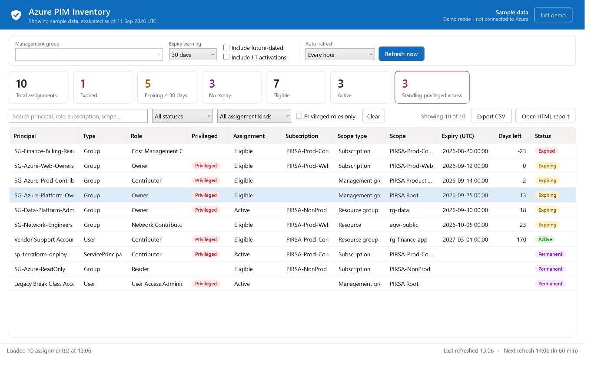

# Azure PIM Assignment Inventory

[](https://github.com/fredlahoud/AzurePIMInventory/actions/workflows/ci.yml)

Exports every PIM role assignment (eligible and active) beneath an Azure management
group to CSV and a self-contained HTML dashboard.

Built for PIRSA, September 2026.

## Why this exists

The Azure portal cannot show you every PIM assignment across a management group
hierarchy in one view. You have to inspect each scope individually, which means
time-bound assignments quietly reach expiry unnoticed. This produces the single
consolidated list, with expiry dates, that the portal does not — and highlights
standing privileged access that bypasses just-in-time elevation.

## Desktop app



A Windows dashboard for people who would rather not use the command line.

1. Download or clone the repository (if downloaded as a ZIP, right-click it →
   **Properties** → **Unblock** before extracting).
2. **Double-click `Start-PimDashboard.cmd`.**
   Optional: run `.\Install-DesktopShortcut.ps1` once to add **Azure PIM Inventory**
   to the Desktop and Start menu with its own icon.
3. Click **Sign in**. Your browser opens for Microsoft sign-in (MFA and Conditional
   Access supported). Enter a tenant ID or domain first if you work across several
   tenants; leave it blank for your home tenant. An existing Azure PowerShell sign-in
   is reused automatically.
4. Pick a management group (the tenant root group is selected by default). The
   inventory loads in the background and the window stays responsive.

| Feature | Details |
|---|---|
| **Auto-refresh** | Choose **Off**, **every 15 / 30 minutes**, **every 1 / 2 / 4 / 8 / 12 hours**, or **Daily at…** a time you type (24-hour, e.g. `07:00`). Default: every hour. The status bar shows the last and next refresh. |
| **KPI cards** | Total, Expired, Expiring, No expiry, Eligible, Active, **Standing privileged access**, Pending. Click a card to filter the grid. |
| **Grid** | Sort any column, search, filter by status / assignment kind / privileged roles. Right-click to copy rows, scope or principal ID, or open the scope in the Azure portal. |
| **Exports** | **Export CSV** and **Open HTML report** use the rows currently shown. |
| **Sample data** | **Explore with sample data** shows the full experience without signing in. |
| **Settings** | Tenant, management group, options and refresh schedule are remembered in `%LOCALAPPDATA%\AzPimInventory\settings.json`. Errors are logged to `app.log` in the same folder. |

The app needs only `Az.Accounts`; if it is missing, the app offers to install it for
your user account (no admin rights). It runs on Windows PowerShell 5.1 or PowerShell 7
(preferred when installed). Auto-refresh runs while the app is open; for unattended
reporting with the app closed, use the scheduled runbook described below.

## Quick start (command line)

```powershell
Install-Module Az.Accounts -Scope CurrentUser   # if not already present
Connect-AzAccount
.\Export-AzPimAssignmentInventory.ps1 -RootManagementGroupId 'your-mg-id'
```

Use your actual management-group ID, not the example `mg-pirsa-root`.
Hierarchies containing only the root management group and no child subscriptions
are supported.

Two files are written to the current directory:

- `PIM-Assignment-Inventory-<timestamp>.csv` — for Excel, Power BI or audit evidence
- `PIM-Assignment-Inventory-<timestamp>.html` — dashboard with filtering, sorting,
  a "privileged roles only" filter and an "export visible rows" button

Preview the output format without connecting to Azure:

```powershell
.\Export-AzPimAssignmentInventory.ps1 -OfflineSampleData .\sample-data.json -ReferenceDateUtc '2026-09-11 01:36'
```

## Requirements

| | |
|---|---|
| PowerShell | 5.1 or 7.x (Windows, Linux, macOS) |
| Module | `Az.Accounts` only. `Az.Resources` is **not** required. Offline mode needs no modules. |
| Azure rights | **Reader** at the root management group is normally enough, because listing needs `Microsoft.Authorization/*/read`. Microsoft documents Owner or User Access Administrator for the PIM ARM API generally, so if calls return 403, grant User Access Administrator. |
| Entra rights | **None.** No Graph permissions, no Global Administrator, no Privileged Role Administrator. |
| Licence | PIM requires Microsoft Entra ID P2 or Microsoft Entra ID Governance. |

## Parameters

| Parameter | Default | Purpose |
|---|---|---|
| `-RootManagementGroupId` | required (live) | Management group ID (the name, not the display name). |
| `-OfflineSampleData` | required (offline) | Preview the output format using a sample JSON file. |
| `-ReferenceDateUtc` | now | Offline only. Instant against which expiry is evaluated, for reproducible output. |
| `-OutputPath` | current directory | Where to write the CSV and HTML. |
| `-ExpiryWarningDays` | 30 | Assignments expiring within this many days are flagged `Expiring`. |
| `-PrivilegedRoleName` | Owner, Contributor, User Access Administrator, Role Based Access Control Administrator | Roles flagged as privileged. |
| `-IncludeActivations` | off | Include transient just-in-time activations. |
| `-IncludeAncestorScopes` | off | Include assignments inherited from above the root management group. |
| `-IncludeFutureAssignments` | off | Also include assignments scheduled to *start* in the future (queries the `*Schedules` resources instead of `*ScheduleInstances`). These get status `Pending`. |
| `-SkipHtml` | off | Produce the CSV only. |
| `-PassThru` | off | Also write the report rows to the pipeline. |
| `-FailOnScopeError` | off | Throw after writing the reports if any scope could not be read, so pipelines and runbooks fail on an incomplete inventory. |

## Output columns

| Column | Notes |
|---|---|
| `PrincipalName`, `PrincipalType`, `PrincipalEmail`, `PrincipalId` | From ARM `expandedProperties`. Deleted principals show `(unresolved)`. |
| `RoleName`, `RoleType` | Role definition display name and `BuiltInRole` / `CustomRole`. |
| `PrivilegedRole` | `Yes` when `RoleName` is in `-PrivilegedRoleName`. |
| `AssignmentKind` | `Eligible`, `Active` or `Activation (JIT)`. |
| `MemberType` | `Direct`, `Group` or `Inherited`. |
| `SubscriptionName` | Resolved from the management-group hierarchy, or `(unresolved: <id>)`. |
| `ScopeName`, `ScopeType`, `Scope`, `ResourceUri` | `ResourceUri` duplicates `Scope`; it is kept for backwards compatibility. |
| `StartDateUtc`, `ExpiryDateUtc` | `yyyy-MM-dd HH:mm`, UTC. |
| `DaysRemaining` | Whole days until expiry; negative once expired; blank when there is no expiry. |
| `Status` | See below. |
| `Condition` | `Yes` when the assignment carries an ABAC condition. |
| `InstanceId` | ARM resource id, used for de-duplication. |

`Status` is one of:

| Status | Meaning |
|---|---|
| `Expired` | End date has passed. |
| `Expiring` | Ends within `-ExpiryWarningDays`. |
| `Active` | Time-bound, not yet within the warning window. |
| `Permanent` | No end date. |
| `Pending` | Start date is in the future (only with `-IncludeFutureAssignments`). |
| `Unknown` | ARM returned an end date that could not be parsed. Never silently reported as `Permanent`. |

Text columns in the CSV that begin with `=`, `+`, `-` or `@` are prefixed with `'`
to prevent spreadsheet formula injection, because display names are user-controlled.
The CSV is UTF-8 with BOM on every PowerShell version so Excel renders it correctly.

## Things worth knowing

**It uses Azure Resource Manager only.** PIM for Azure resources is an ARM API, not
a Microsoft Graph API. Principal, role and scope display names come from the ARM
`expandedProperties` payload, so no directory permissions are needed.

**Do not try to rebuild this on Azure Resource Graph.** Resource Graph cannot see
eligible assignments — its `authorizationresources` table has no eligible-schedule
type. A report built on it returns permanent assignments only and omits every
eligible assignment silently, with no error.

**Coverage is explicit rather than assumed.** ARM returns assignments at, above and
below a queried scope, but Microsoft documents that behaviour from a subscription
scope, not from a management group root. The script therefore enumerates the root
management group plus all descendant management groups and subscriptions, queries
each, and de-duplicates on instance ID. Slower, but correct either way.

**Ancestor filtering is exact.** Assignments from above the root are removed by
exact scope matching, so a sibling such as `mg-prod-legacy` is never mistaken for
part of `mg-prod`.

**Just-in-time activations are excluded by default.** An activated eligible
assignment appears as an active instance with `assignmentType = 'Activated'` and
would otherwise add rows that disappear within hours.

**Assignments made outside PIM are included.** The active-assignment API also
returns permanent RBAC granted outside PIM entirely, so standing access that
bypassed PIM shows up in the report. The dashboard counts these for privileged
roles as **Standing privileged access** — usually the most interesting number.

**Future-dated assignments are hidden by default.** Microsoft: *"schedule instances
only include assignments that are active at the current time, schedules also include
assignments that will become active in the future."* The script queries schedule
instances by default, so it reports the estate as it stands today. Add
`-IncludeFutureAssignments` to see assignments scheduled to start later.

**Groups are not expanded.** Where a group holds the assignment, the group is
reported as the principal. Expanding to individual members would require Microsoft
Graph directory permissions.

**Partial failures are visible.** If a scope cannot be read the run continues, and
the affected scopes are listed in a warning banner at the top of the HTML report,
so an incomplete inventory can never be mistaken for a clean one. Add
`-FailOnScopeError` to make the run fail as well.

**Throttling is handled.** ARM `429` and `5xx` responses are retried with
`Retry-After` honoured (seconds or HTTP-date) and exponential backoff otherwise.

## Scheduling it

For unattended runs, use an Azure Automation account (PowerShell 7.2+ runtime) with a
system-assigned managed identity granted **Reader** at the root management group,
and import `Az.Accounts`. In the runbook:

```powershell
Connect-AzAccount -Identity | Out-Null
.\Export-AzPimAssignmentInventory.ps1 -RootManagementGroupId 'your-mg-id' `
    -OutputPath $env:TEMP -FailOnScopeError
# Then copy the CSV/HTML to a storage account or SharePoint library.
```

Point Power BI at that folder if a refreshable dashboard is wanted.

## Development

Branches:

| Branch | Purpose |
|---|---|
| `main` | Released, reviewed code. |
| `dev` | Integration branch for testing. Changes land here first, then go to `main` by pull request. |

Run the checks locally:

```powershell
Install-Module Pester -MinimumVersion 5.5.0 -Scope CurrentUser -SkipPublisherCheck
Install-Module PSScriptAnalyzer -Scope CurrentUser

Invoke-Pester ./Tests -Output Detailed
Invoke-ScriptAnalyzer -Path . -Recurse -Settings ./PSScriptAnalyzerSettings.psd1
```

Use the module directly in your own scripts:

```powershell
Import-Module ./src/AzPimInventory/AzPimInventory.psd1
$inventory = Get-PimInventory -RootManagementGroupId 'your-mg-id'
$inventory.Rows | Where-Object Status -eq 'Expiring'
Export-PimInventoryHtml -Inventory $inventory -Path ./pim.html
```

GitHub Actions runs the same lint and tests on Windows PowerShell 5.1, PowerShell 7
on Windows and PowerShell 7 on Linux for every push and pull request to `main` and
`dev`, and publishes the offline sample report as a build artifact.

## Files

| File | Purpose |
|---|---|
| `Start-PimDashboard.cmd` | Double-click to open the desktop dashboard. |
| `Install-DesktopShortcut.ps1` | Adds Desktop and Start menu shortcuts (`-Remove` to undo). |
| `App\` | Desktop dashboard: `PimDashboard.ps1`, `MainWindow.xaml`, icon. |
| `src\AzPimInventory\` | PowerShell module with the collection, CSV and HTML logic, shared by the app and the script. |
| `Export-AzPimAssignmentInventory.ps1` | Command-line script (for automation and runbooks). |
| `sample-data.json` | Sample ARM payloads for offline preview. Not real data. |
| `SampleOutput\` | Example CSV and HTML generated from the sample data. |
| `Tests\` | Pester 5 test suites for the module, script and app logic. |
| `docs\images\` | Screenshots. |
| `PSScriptAnalyzerSettings.psd1` | Lint rules used locally and in CI. |
| `.github\workflows\ci.yml` | CI pipeline. |
| `CHANGELOG.md` | Release notes. |
